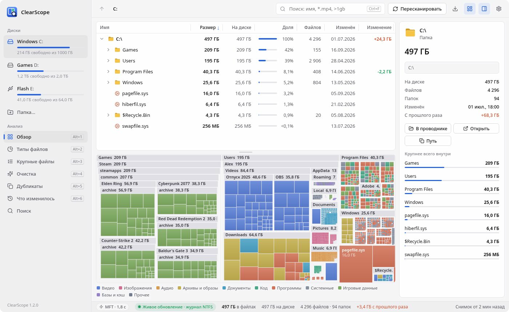

<p align="center">
  
</p>

<h1 align="center">ClearScope</h1>

<p align="center">
  Показывает, чем забит диск. Быстро.<br>
  <a href="https://github.com/wtf40iq/ClearScope/releases/latest"><b>Скачать для Windows</b></a>
  &nbsp;·&nbsp;
  <a href="CHANGELOG.md">Что нового</a>
</p>

<p align="center">
  <picture>
    <source media="(prefers-color-scheme: dark)" srcset="docs/screenshot-dark.svg">
    
  </picture>
</p>

Я долго пользовался WizTree, и он отличный. Но хотелось того же самого, только
с интерфейсом, на который приятно смотреть, с живым обновлением и с защитой от
случайного удаления чего-нибудь важного. Так появился ClearScope.

Диск на полмиллиона файлов сканируется за пару секунд: программа читает
таблицу MFT напрямую, как это делает WizTree, а не обходит папки по одной.

## Что умеет

**Сканирует быстро.** С правами администратора ClearScope читает MFT целиком
и разбирает её на всех ядрах. Без прав, на флешках с FAT/exFAT и на сетевых
дисках работает многопоточный обход папок. Он медленнее, но тоже шустрый.

**Не устаревает.** Пока окно открыто, изменения на диске подтягиваются сами:
скачали фильм, и он через секунду появился в списке. На NTFS для этого используется
журнал USN, на остальных дисках — обычное наблюдение за папками.

**Открывается мгновенно.** Результат прошлого сканирования сохраняется, и при
следующем запуске вы сразу видите диск, а изменения догружаются в фоне.

**Показывает по-разному.** Дерево папок с сортировкой и растягиваемыми колонками,
карта диска (treemap), разбивка по типам файлов, топ крупных файлов, поиск
вроде `*.mp4 >1gb`. Есть экран «Что изменилось»: какие папки выросли с прошлого раза.

**Помогает почистить.** Раздел «Очистка» находит временные файлы, кэш браузеров и
видеодрайвера, старые `node_modules` и `target`, остатки обновлений Windows,
установщики в «Загрузках». Отдельно есть поиск дубликатов.

**Бережёт систему.** Удалить `C:\Windows`, `pagefile.sys` или папку профиля
не получится. Для `Program Files` и `AppData` нужно отдельное подтверждение.
По умолчанию всё уходит в корзину.

## Установка

Скачайте `ClearScope_x.y.z_x64-setup.exe` со [страницы релизов](https://github.com/wtf40iq/ClearScope/releases/latest)
и запустите. Права администратора для установки не нужны: программа ставится в
профиль пользователя и удаляется как обычно, через «Параметры → Приложения».

Нужна Windows 10 или 11. WebView2 там уже есть, а если вдруг нет, установщик докачает его сам.

Чтобы сканировать через MFT, ClearScope нужно запустить от администратора.
Можно нажать «Быстрый режим» прямо в программе или включить в настройках
«Всегда с правами администратора».

## Обновления

При запуске ClearScope заглядывает в релизы этого репозитория. Если вышла новая
версия, появится окно с кнопками «Обновить» и «Обновить позже». Если отложить,
обновление тихо поставится при следующем запуске. Проверку можно отключить в
настройках, там же есть кнопка «Проверить сейчас».

Обновления подписаны ключом, так что программа не поставит файл, который
собран не здесь.

## Горячие клавиши

| Клавиша | Что делает |
|---|---|
| `Alt+1` … `Alt+6` | переключение разделов |
| `Ctrl+F` | поиск |
| `F5` | пересканировать |
| `Backspace` | на уровень выше |
| `Del` / `Shift+Del` | в корзину / удалить навсегда |
| `I` | панель сведений |
| `M` | показать или скрыть карту |
| `H` | скрыть мелкие файлы и пустые папки |
| `Esc` | закрыть окно или меню |

## Частые вопросы

**Почему без прав администратора медленнее?**
Читать MFT напрямую Windows разрешает только администратору. Без этого остаётся
обходить папки через обычный API, а это в разы дольше.

**Куда сохраняются данные?**
В `%APPDATA%\app.clearscope.desktop`. Там кэш последних сканирований и снимки для
экрана «Что изменилось». Папку можно спокойно удалить.

**Программа что-нибудь отправляет в интернет?**
Только один запрос при запуске: проверку новой версии на GitHub. Если выключить
её в настройках, не будет и его.

## Сборка из исходников

Понадобятся [Node.js 20+](https://nodejs.org), [Rust](https://rustup.rs) и
Visual Studio Build Tools с компонентом «Разработка классических приложений на C++».

```powershell
npm install
node scripts/icons.mjs   # иконки из SVG
npm run tauri dev        # запуск для разработки
npm run tauri build      # установщик в src-tauri/target/release/bundle/nsis
```

Интерфейс можно погонять и в браузере, на демо-данных: `npm run dev` и
http://localhost:1420.

Код устроен так:

```
core/        движок на Rust: чтение MFT, обход папок, журнал USN, кэш, анализ
src-tauri/   само приложение: команды для интерфейса, работа с WinAPI
src/         интерфейс на React
scripts/     иконки и тексты релизов для CI
```

### Как выпустить новую версию

1. Поднять версию в `package.json` и `src-tauri/Cargo.toml`.
2. Дописать раздел в `CHANGELOG.md`, он станет текстом релиза и окна обновления.
3. Запушить в `main`.

GitHub Actions соберёт установщик, подпишет его и опубликует релиз, а у
пользователей появится предложение обновиться. Для подписи в секретах
репозитория должен лежать `TAURI_SIGNING_PRIVATE_KEY`. Без него установщик
всё равно соберётся, но автообновление его не увидит.
